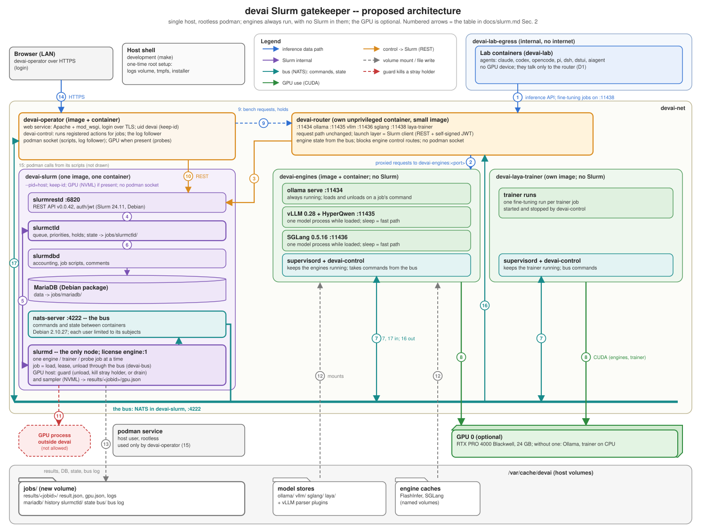

# Slurm gatekeeper -- architecture

**Status: proposed (2026-10-01; implementation decisions folded in
2026-10-05), not built.** This is the design the phases of
[the plan](plans/platform-rebuild.md) implement. The plan holds:

- the operator's decisions: D1-D16, plus M1-M15 and O1-O9 for the images and
  the operator;
- the implementation decisions I1-I14, which this document includes where they
  shape the design;
- the interfaces the code is written against (its contracts C1-C8).

**(measured)** marks a fact measured on this host in an
earlier spike (2026-09-29) or read in an engine's source; that spike tested two
layouts since discarded and is obsolete, so only facts that do not depend on the
layout are marked this way. The spike ran Slurm 26.05.4; the design now uses
Debian's 24.11.5 (D12), which ships the same plugins (checked 2026-09-30) but
has not been run yet. **(untested)** marks what nothing has run yet; everything
else is proposal. Once built, this document is the source of truth for Slurm in
devai, as [router.md](router.md) is for the router.

This is the fourth layout. The first (one Slurm node per backend image) had far
too many moving parts; the second put Slurm and every backend into one image;
the third had Slurm jobs start engines inside the backend containers with
`podman exec`. The operator then decided (D15-D16): **engines run all the
time**, kept running by their own supervisor in their own container; **a Slurm
job only loads a model onto the GPU and unloads it**; and a **message bus**,
NATS inside `devai-slurm`, carries commands and state between containers.

## 1. What changes

Today the router starts engines itself: for every model switch it recreates a
podman container, and it decides what holds the GPU from its own flags. It
never looks at the card, so an engine can start on a GPU another process still
holds -- the failure that cost the re-bench of 2026-09-28 a day.

Proposed:

- **Slurm decides what is on the GPU.** It runs in one container,
  `devai-slurm`: controller, accounting with MariaDB, REST API and the node
  daemon, a single-node cluster. One cluster license lets one engine, trainer
  or probe job hold the GPU at a time, with or without a GPU; Slurm also queues
  work and records every job.
- **Engines run all the time and carry no Slurm.** `devai-engines` (Ollama,
  vLLM, SGLang; built in
  [the plan](plans/platform-rebuild.md)'s Phase 4) and
  `devai-laya-trainer` run supervisord, which keeps their services running.
  Nothing in `devai-slurm` starts or stops them. A job tells an engine to load
  a model and, when the job ends, to unload it (Sec. 4).
- **The bus.** NATS, inside `devai-slurm`, connects a small control service,
  `devai-control`, in every devai container. Jobs send it load and unload
  commands; the operator sends it start, stop, restart and reload for any
  service; every control service publishes its state, which the router and the
  operator follow.
- **The router** stays a separate, unprivileged container and the only entry
  point for inference; its launch layer becomes a Slurm client, and it reads
  engine state from the bus.
- **The operator's interface is `devai-operator`,** a web service in its own
  image and container ([the plan](plans/platform-rebuild.md), Phase 6). Its actions --
  builds, pulls, probes, benches, backups -- are devai's scripts, run as Slurm
  jobs; `devai-control` in `devai-operator` runs each one on its job's
  command. The host shell stays for development and the one-time root setup.
- **The GPU guard** in `devai-slurm` checks the card before every GPU job: it
  asks devai's engines to unload and kills anything else that holds it.
- **Only `devai-operator` holds the host's podman socket** (builds, compose,
  lab containers). `devai-slurm` and the router do not.
- **One version per backend, CUDA 13.1, everything compiled here** (D8, D11).
- **The GPU is optional** (M15): one host check decides
  at launch; a host without an NVIDIA GPU runs only Ollama (CPU) and the laya
  trainer, and `devai-slurm` skips the guard and the sampler.

## 2. Architecture at a glance



Source: [`scripts/diagrams/slurm_architecture.py`](../scripts/diagrams/slurm_architecture.py)
(explicit coordinates; stdlib only). Re-render with
`python3 scripts/diagrams/slurm_architecture.py`.

| # | From -> to | What | How | Status |
|---|---|---|---|---|
| 1 | lab agents -> router | inference (OpenAI, Anthropic, Ollama APIs); fine-tuning jobs on :11438 | HTTP, `devai-lab-egress` | unchanged |
| 2 | router -> engine | proxied requests to `devai-engines:<port>` | HTTP, `devai-net` | today's path, new host name |
| 3 | router -> slurmrestd | submit, cancel, job and node state | REST v0.0.42, JWT the router signs itself | measured on 26.05 (v0.0.44) |
| 4 | slurmrestd -> slurmctld | the same, as Slurm RPC | inside `devai-slurm` | measured |
| 5 | slurmctld <-> slurmd | launch, signal, kill the job script; node health | inside `devai-slurm` | measured |
| 6 | slurmctld -> slurmdbd -> MariaDB | accounting records | inside `devai-slurm` | measured |
| 7 | job scripts, guard -> bus -> `devai-control` | load, unload, sleep, lease a model; train; run an operator action | NATS request/reply, `devai-net` | untested |
| 8 | engine, trainer -> GPU | CUDA (on a host with a GPU) | device via CDI | measured (engines on this card today) |
| 9 | operator jobs -> router | a bench's inference requests; hold / release | HTTP | requests measured; holds proposed |
| 10 | `devai-operator` -> slurmrestd | actions submitted as jobs; queue, history | REST + JWT | proposed |
| 11 | GPU guard -> stray process | SIGTERM, then SIGKILL; if still busy, drain (on a host with a GPU) | signals (`--pid=host`) | measured |
| 12 | host volumes -> containers | model stores, engine caches, the laya store | mounts | measured (model store, FlashInfer cache) |
| 13 | `devai-slurm` -> `jobs/` | results, GPU samples, the bus log, MariaDB files, controller state | files | proposed |
| 14 | browser -> `devai-operator` | the web service: actions, jobs and logs, lab links, host setup | HTTPS, login | proposed |
| 15 | `devai-operator` -> podman | its scripts' podman calls: builds, compose, bench and lab containers | the host's podman socket | proposed |
| 16 | `devai-control` -> bus -> router, operator, bus log | state events: idle, loading, serving, sleeping, unloading, failed | NATS publish/subscribe | untested |
| 17 | `devai-operator` -> bus -> `devai-control` | start, stop, restart, reload a service | NATS request/reply | untested |

## 3. Containers and images

| Container | Image | Holds | Privileges |
|---|---|---|---|
| `devai-slurm` | `devai-slurm` (new, built here on the pinned `debian:trixie-slim`) | slurmctld, slurmdbd, slurmrestd, MariaDB, slurmd, nats-server, the GPU guard, the GPU sampler, the bus log, `devai-bus`, `devai-jobs` | `--pid=host`; the GPU via CDI, for NVML only, when the host has one; `--privileged --cgroupns=private` only if slurmd turns out to need them (Sec. 3.1) |
| `devai-engines` | `devai-engines` (the plan's Phase 4) | supervisord, `devai-control`, Ollama, vLLM 0.28 + HyperQwen, SGLang 0.5.16, each in its own env and on its own port (11434, 11435, 11436) | GPU via CDI when present |
| `devai-laya-trainer` | `devai-laya-trainer` (its own image, as today, on `devai-base`; the plan's Phase 3) | supervisord, `devai-control`, the laya trainer | GPU via CDI when present |
| `devai-operator` | `devai-operator` ([the plan](plans/platform-rebuild.md), Phase 6) | supervisord, Apache + mod_wsgi, `devai-control`, `devai-bus`, `devai-jobs`, devai's scripts and the tools they call | the host's podman socket read-write; the GPU when present (probes); HTTPS published on the LAN (O6) |
| `devai-router` | its own small image | the router, with a bus client that follows engine state and unloads a sleeper no job needs (I9) | none |

No Slurm package is installed outside `devai-slurm`. `devai-control` (the
control service in each container) and `devai-bus` (a command-line client for
job scripts, the guard and the operator) are static Go binaries from
`devai-tools`, built with the NATS Go client (`nats.go`, pinned in `go.sum`);
the same two binaries go into every image that needs them. They share the bus
definitions, the Slurm REST client and the engines' argument builders with the
router, as packages of the router's Go module (I2). `devai-jobs`, the job queue
and history tool (Sec. 9), runs only in `devai-slurm` and `devai-operator`
(I13).

### 3.1 `devai-slurm`

- **Image:** Debian trixie packages only -- Slurm 24.11.5 (`slurmctld`,
  `slurmd`, `slurmdbd`, `slurmrestd`, `slurm-wlm-jwt-plugin`,
  `slurm-wlm-mysql-plugin`; D12), MariaDB 11.8, `nats-server` 2.10.27,
  supervisor, tini and `python3-minimal` -- plus `devai-bus`, `devai-jobs` and
  devai's scripts in `/usr/local/lib/devai/`. Among those scripts is
  `devai-gpu`, the NVML reader the guard and the sampler use: stdlib Python
  through `ctypes`, because `nvidia-smi` on this driver does not expose the
  energy counter (measured; I3). No podman client and no source build. Checked in
  the Slurm packages (2026-09-30): REST data parsers v0.0.40 to v0.0.42,
  `auth_slurm` (which also serves `cred/slurm`; SchedMD's 26.05 build had no
  separate `cred_slurm` plugin either, and `CredType=cred/slurm` worked there),
  `auth_jwt`, `accounting_storage_mysql`, `proctrack_linuxproc`,
  `proctrack_cgroup`, `cgroup_v2`, `jobacct_gather_cgroup`. Build stage and
  final image both use the one digest-pinned `debian:trixie-slim` Makefile
  variable every devai image shares (M13).
- **Privileges:** `--pid=host` lets the guard and the sampler see and signal
  GPU processes, whose PIDs NVML reports in the host namespace (measured); the
  GPU device, on a host that has one, is there only for NVML (the guard, the
  sampler) -- no CUDA work runs here. The earlier layouts also needed
  `--privileged --cgroupns=private` and an entrypoint step that moves the
  container's processes out of its cgroup root, because slurmd confined the
  engines in cgroups (measured: without that step slurmd stops with
  "Controller memory is not enabled"). Here a job script is a short bash
  script that sends bus commands, so this layout proposes
  `ProctrackType=proctrack/linuxproc`, no cgroup plugins and an unprivileged
  container. Whether slurmd runs that way is untested; the measured
  privileged setup is the fallback.
- **Processes:** supervisord runs MariaDB, slurmdbd, slurmctld, slurmrestd,
  slurmd, nats-server and the bus log (Sec. 9).
- **Slurm configuration:**
  - One node, `devai`, with no GPU resource declared.
  - Its `CPUs=` and `RealMemory=` are written at start from the host, with
    `SlurmdParameters=config_overrides` (I4): the CPU count from `nproc --all`
    (`slurmd -C` counts only 8 of 24 CPUs; measured), and `MemTotal`.
  - `select/cons_tres` with `CR_CPU` and one CPU per job, so a host runs as
    many jobs at once as it has CPUs.
  - Two cluster licenses: `engine:1`, and `bench:1`, which keeps bench tasks
    one at a time (I5).
  - Further: `CompleteWait=30`; one partition; `auth/slurm` plus `auth/jwt`;
    `proctrack/linuxproc`; `AccountingStoreFlags=job_comment,job_script`;
    `KillWait=30`; `PrologFlags=Alloc`; `Prolog` / `Epilog` = the guard; a
    health check every 30 s (Sec. 6).
  - MariaDB runs with
  `--innodb-snapshot-isolation=OFF` (measured: 11.8's default makes slurmdbd
  warn it will die on a write conflict).
- **NATS configuration:** one user per client, each limited to its subjects
  (Sec. 12); no JetStream -- nothing is stored in the bus: a service's state is
  asked for or published.
- **Users:** every job runs as one Slurm user, `devai` (uid 1000), which the
  router's and the operator's JWTs name; `devai` has Slurm's
  `AdminLevel=Operator`, for hold, release and node resume. slurmrestd runs as
  its own user, `slurmrest`, since it will not run as root (I6).
- **Ports on `devai-net`:** 6820 (slurmrestd), 4222 (NATS). Nothing else is
  exposed, and nothing is published to the host (I13).

## 4. How a job loads a model (untested)

Every command is a NATS request to `devai.<container>.<service>.<verb>`, for
example `devai.engines.vllm.load`; `devai-control` in that container answers.
State events go to `devai.events.<container>.<service>`. The plan's contracts
C1 and C2 fix the subjects, the messages, the bus users and the fields of a
load request.

| Verb | Sent by | What `devai-control` does |
|---|---|---|
| `start`, `stop`, `restart` | operator | the same on the service's supervisord program |
| `reload` | operator | re-reads the program's configuration and restarts it if it changed |
| `state` | router, operator, jobs | answers: idle, loading, serving *model*, sleeping *model*, unloading, failed (with the log tail) |
| `load` | engine and probe jobs | loads the model (below); answers when it serves or has failed |
| `unload` | engine and probe jobs, the guard; the router, for a sleeper no job needs (I9) | frees the GPU (the loaded model, or the sleeping one); answers once the program has exited and NVML's used memory is back to where it was before that load |
| `sleep` | engine jobs (fast path) | puts a vLLM or SGLang model to sleep (below); it sleeps until a load wakes or replaces it, or the router unloads it |
| `lease` | the job that loaded the model, every 10 s | no answer; after 60 s without one, `devai-control` unloads |

The laya trainer takes `train` and `cancel` (`devai.laya-trainer.trainer.*`);
`devai-operator` takes `run` and `stop` (`devai.operator.actions.*`), and runs
only actions from its registry, with parameters checked against it
([the plan](plans/platform-rebuild.md), C8).

What load and unload mean for each engine:

- **Ollama:** `ollama serve` runs all the time, with `OLLAMA_KEEP_ALIVE=-1`
  (it never unloads by itself) and `OLLAMA_MAX_LOADED_MODELS=1`. Load is a
  request without a prompt and with `keep_alive: -1`; unload is `keep_alive: 0`,
  after which `devai-control` waits until `/api/ps` is empty and NVML shows
  the runner gone (today's router sleeps a fixed 2 s instead). A load whose
  server settings -- context length, KV cache type, flash attention -- differ
  from the running server's first restarts `ollama serve` with them, as the
  router's container recreate does today (I8). The context length matters as
  much as the KV type: a `/v1` request uses the server's default context, and
  a mismatch with the loaded context makes Ollama load the model again. Ollama also loads a model by itself for any request that names one;
  the router forwards only requests for the loaded model, and nothing else
  reaches `devai-engines` (Sec. 12).
- **vLLM and SGLang** serve one model per process, with the model, context,
  KV type, parsers and MTP fixed when the process starts (measured in the vLLM
  0.28 source and the SGLang 0.5.16 image: neither can switch models in a
  running process). So the part that runs all the time is `devai-control`
  (D15).
  - The `load` request carries today's router launch configuration as data,
    never as a command line: model, context, KV type, parsers, MTP, memory
    fraction.
  - `devai-control` builds the command line from it with the router's own
    argument builders, and adds the model's recovery flags and parser plugins
    from the same files the router reads. It writes the result into that
    engine's supervisord program and starts it (I1).
  - So a job cannot run arbitrary commands in `devai-engines`, and probes and
    serving launch identical command lines.
  - Each engine has its own `HOME`, and so its own caches.

  Before a vLLM start, `devai-control` deletes vLLM's compile cache
  (`~/.cache/vllm`, `/tmp/torchinductor_*`): with that cache a restart reached `/health` in
  27-29 s instead of 95 s (measured), but it under-measures activation memory
  and OOM-killed engines on 2026-09-23 (docs/router.md). Unload stops the
  program: SIGTERM, then SIGKILL after 30 s, to its whole process group
  (supervisord's `stopasgroup` / `killasgroup`). Every model process is started
  with its engine's sleep support: vLLM `--enable-sleep-mode` with
  `VLLM_SERVER_DEV_MODE=1` (which the `/sleep` and `/wake_up` routes need;
  measured in the source), SGLang `--enable-memory-saver`.
- **Sleep, the fast path** (D15): when the router switches away from a vLLM or
  SGLang model that a pending job will need again -- the D1 interrupt, where
  the suspended bench's re-run (D13) is such a job -- the engine job ends with
  `sleep` instead of `unload`. vLLM's `/sleep?level=1` moves the weights to host
  RAM and drops the KV cache; SGLang's `/release_memory_occupation` releases its
  memory. The next `load` of the same model with the same settings wakes it
  (`/wake_up`, `/resume_memory_occupation`) instead of starting a process. At
  most one model sleeps at a time; a second sleep unloads the first. Once no
  pending job names the sleeping model any more -- its job was cancelled, or
  it ran with other settings -- the router unloads it (I9). A sleeping
  model costs host RAM (about 18 GiB for the 27B at level 1; the host has
  62 GiB) and keeps some VRAM (not measured), which the next load's memory
  fraction must leave free. How long sleep and wake take is not measured.
- **The laya trainer:** the controller, which serves the :11438 API, runs all
  the time and no longer starts runs itself. `train` starts one run
  (`laya_trainer.run_job`, which the controller used to spawn) as a
  supervisord program; `cancel` stops it (I11).

The engine job script. The router submits only
`exec /usr/local/lib/devai/jobs/engine.sh`; the job scripts ship in the
`devai-slurm` image. The load request, with the router's launch
configuration, arrives in the job's environment:

```bash
#!/bin/bash
S=devai.engines.$DEVAI_BACKEND J=$SLURM_JOB_ID
trap 'devai-bus request $S.unload "{\"job\":$J}" --timeout 25s; exit 0' TERM INT
trap 'devai-bus request $S.sleep "{\"job\":$J}" --timeout 120s; exit 0' USR1
devai-bus request $S.load "$DEVAI_LOAD" --job "$J" --timeout 660s || exit 1
devai-bus hold $S --job "$J" &   # a lease every 10 s; exits when the engine stops serving this job
wait $!
```

If the trap's `unload` does not finish within `KillWait`, the epilog sends it
again and waits up to 60 s.

| Concern | Who does it |
|---|---|
| a model onto the GPU | the job's `load`; `devai-control` starts or loads it |
| cancel (`scancel`, time limit) | Slurm sends the job script SIGTERM; its trap sends `unload`; the epilog sends `unload` again and checks the card (Sec. 6) |
| switch away, fast path | the router cancels with `scancel --signal=USR1 --batch`; the trap sends `sleep` |
| the engine fails | `devai-control` publishes `failed`; `devai-bus hold` exits; the job ends non-zero |
| the job disappears without its trap or epilog (`devai-slurm` restarts) | the lease runs out after 60 s and `devai-control` unloads |
| GPU memory and utilisation (a host with a GPU) | a sampler started by the prolog polls NVML every 5 s and writes `results/<jobid>/gpu.json`; the epilog stores its peak and mean in the job's `AdminComment`. There is one GPU job at a time, so the whole card is the job's |
| GPU energy | NVML's energy counter at prolog and epilog, read through `ctypes` (I3); Slurm reads none on NVIDIA (measured) |

devai does not use Slurm's own suspend: a suspended job script would stop
renewing its lease. Bench jobs are re-run instead (D13), and engine jobs end
with `sleep` or `unload`.

## 5. Jobs

| Kind | License | Target | Runs | Time limit | Submitted by |
|---|---|---|---|---|---|
| engine | `-L engine` | `devai.engines.<backend>` | load, hold, unload (or sleep) | none (keep-warm) | router only |
| trainer | `-L engine` | `devai.laya-trainer.trainer` | one fine-tuning run | `LAYA_MAX_HOLD_S` (900 s), whether or not another backend waits (I11) | router (:11438 API), once the controller has accepted the job |
| probe | `-L engine` | `devai.engines.<backend>`, with the prober in `devai-operator` | load with the probe's settings, measure, unload | 60 min | `devai-operator` (probe actions) |
| bench | `-L bench` | `devai.operator.actions` (the bench-task action) | one bench task: hold, run, `result.json`, release | `--time=32 --signal=B:INT@120` | `devai-operator` (`bench-sync.py --submit`) |
| operator action | none | `devai.operator.actions` | one of devai's scripts: pull, build, backup, ... | per action | `devai-operator` |

A bench uses the GPU only through the router and keeps its engine with a hold
(Sec. 7). So it takes no engine license; if it did, its own engine job could
never start. The `bench` license only keeps bench tasks one at a time (I5).
The engine license, not the GPU, is what lets one engine run at a time, so the
rule is the same on a host without a GPU: a second job asking for it waits as
`PENDING (Licenses)` (measured). `CompleteWait=30` makes Slurm start nothing
while a job is still completing, so the next job's prolog always follows the
previous job's epilog (Slurm's documented behaviour; not measured). On a host
without a GPU the router submits only Ollama and trainer jobs; vLLM and SGLang
requests are refused before anything is submitted. Every job carries a JSON
comment (kind, backend, model, context, MTP, hold, requester, git commit);
submitted through REST it arrives intact (measured). Every job runs as the
Slurm user `devai` (I6), and keeps its log and results in
`/var/cache/devai/jobs/results/<jobid>/` (Sec. 9).

## 6. GPU guard

The prolog runs for every job (`PrologFlags=Alloc`) and first creates the
job's results directory. On a host with a GPU, the prolog of every engine,
trainer and probe job, in `devai-slurm`:

1. waits up to 10 s for an idle card: no compute process and at most 512 MiB
   used, apart from a sleeping devai model, whose use it takes from that
   engine's state;
2. otherwise asks each devai engine that holds the card to `unload`, over the
   bus, and waits up to 60 s. The guard matches NVML's PIDs to a container
   through `/proc/<pid>/cgroup`: a PID's cgroup is compared with that of the
   `devai-control` process whose command line names the container. A devai engine is
   asked, not killed: its supervisor would start a killed service again;
3. sends every other holder SIGTERM, then SIGKILL after 5 s (measured from a
   privileged container with `--pid=host`: a PyTorch process in another
   container died and the card went back to 2 MiB; the same from an
   unprivileged container is untested);
4. if the card is still busy, or a holder belongs to another user, exits 1:
   Slurm drains the node and holds the job, so nothing starts on a busy card
   (measured);
5. starts the GPU sampler and reads the energy counter.

The epilog stops the sampler, writes `gpu.json`, sends the job's engine
`unload` unless the job ended with `sleep`, and checks the card is idle again
(apart from a sleeping model); if not, it exits 1 and the node drains. With one
node and `CompleteWait`, this check cannot race the next job. On a host without
a GPU, prolog and epilog only send `unload`.

The prolog writes its verdict to `results/<jobid>/guard.json` and publishes it
on `devai.events.slurm.guard`. The router reads the holder from that event and
names it in its 503. A health check (`HealthCheckProgram`, every 30 s) resumes
a node that the guard or a failed epilog drained, once the card is idle again
(I7; untested). Without it, a drained node would run nothing until someone
resumed it by hand.

## 7. Router

The request path stays: listeners, override parsing, API normalisation,
reasoning policy, tool stripping, admission, SSE keepalive, drain, the mutation
guard, and the launch configuration it computes from the probe caches. The
podman launch layer goes (`containerRecreate`, `stopOtherBackends`,
`unloadOllama`, `backendVanished`, the job-runner hold), and with it the
router's podman socket and the per-engine containers. This happens in one
step, with no switch back; rollback is reverting that change (I10). Instead
there are three new parts:

- a Slurm client;
- a bus client that follows engine state;
- one GPU record, rebuilt from Slurm and the engines' state on boot and
  refreshed on every decision.

Unlike today, the record knows which model a running engine serves, so a
restarted router proxies to it without a load. The router signs its own HS256 JWT with
the shared key (measured: slurmrestd accepts it).

It also blocks the engines' control routes on every listener, as it blocks
Ollama's store-changing paths today: vLLM's development routes (`/sleep`,
`/wake_up`, `/collective_rpc`, weight updates and the rest that
`VLLM_SERVER_DEV_MODE` turns on) and SGLang's memory and weight routes
(`/release_memory_occupation`, `/resume_memory_occupation`,
`/update_weights_from_disk`). Only `devai-control` calls them, inside
`devai-engines`.

A request that needs an engine:

1. the right engine job is running and its engine is serving: proxy;
2. the job is pending, or its engine is loading or waking: wait, with SSE
   keepalive;
3. the GPU holds something else: a trainer job, or an engine bound to an active
   hold, gets the client a 503 with `Retry-After`; an ordinary engine is
   drained and its job ended -- with `sleep` if a pending job needs that model,
   with `unload` otherwise -- and a new engine job submitted;
4. the new job is refused by the guard: cancel it and return 503 naming the
   holder, without charging the launch breaker, and resubmit rather than
   release (Slurm delays a released job by about 2 minutes; measured); the load
   fails: 502 with the engine's log tail from `devai-control`, breaker charged.

**Yielding.** A pending trainer or probe job makes the router end its engine
job, unless a hold binds that engine. Otherwise a keep-warm engine job would
keep the engine license forever.

**The sleeper.** Once no pending job names the sleeping model any more, the
router sends `unload` for it (I9). It checks this whenever it refreshes the
pending jobs (every 2 s) and at boot. While the router is down, a sleeper
stays.

**Holds.** A bench keeps its engine for its whole run:
`POST /devai/v1/holds {job_id, model}` starts or keeps the engine and answers
when it is serving; `DELETE /devai/v1/holds/{job_id}` releases it. A hold is
active while its job runs and is dropped when the job ends. The router checks
a hold against Slurm: its job must be running and must name the same backend
and model, so a lab client cannot hold an engine. `GET /devai/v1/gpu` shows
the record.

**Fine-tuning on :11438.** The router forwards a create to the laya
controller. Once the controller has accepted the job, the router submits the
trainer job. A cancel is forwarded to the controller and the trainer job is
cancelled. Reads go to the controller, which always runs (I11).

Measured timings that carry over: REST submit to running 1.0-1.3 s; the 27B
engine healthy about 95 s after a cold start. Waking a sleeping model: not
measured.

## 8. Flows

- **Switch:** drain the current engine, end its job (`unload`, or `sleep` when
  a pending job needs the model), submit the new one; the guard checks the
  card; the new job loads its model.
- **Bench:** one bench job per (model, task), one at a time (license `bench`,
  I5), runs the bench-task action in `devai-operator`.
  - The action starts a lab-image container that holds the GPU device for NVML
    reads only, with `CUDA_VISIBLE_DEVICES` empty (I12).
  - There the task takes a hold, runs, writes `result.json` and releases the
    hold.
  - At
  30 minutes Slurm sends SIGINT and the job scores the unbroken prefix, as
  `harvest_truncated.py` does today.
- **Suspending a bench job** (D13) does not freeze it, because inspect's
  per-sample clock would keep running: the running task is cancelled and the
  same task is submitted again, held, and the run's other pending tasks are
  held too. Resume releases the re-run, waits until it runs, then releases the
  rest (I5). The task starts again from its first sample. The cancelled attempt keeps its log and is not
  scored. Whether a released job starts without delay is untested (a requeued
  job waited about 130 s in the spike, which is why this resubmits instead).
- **Interrupt, same model** (D1): suspend the bench job, run the quick job on
  the loaded model, resume. Nothing is loaded or unloaded.
- **Interrupt, another model:** suspend the bench job; its re-run is now a
  pending job that needs the model, so when the quick job arrives the router
  ends the bench's engine job with `sleep` and the quick job's engine loads.
  On resume the bench's task takes its hold again and the sleeping model wakes
  (the fast path). An Ollama model is unloaded and loaded again instead; it has
  no sleep.
- **Restarts:** the router rebuilds its record from Slurm and the bus, and
  engines keep serving meanwhile. If `devai-slurm` restarts, running job
  scripts and the bus go with it; engines keep serving until their lease runs
  out (60 s) and then unload, because Slurm no longer has a job for them; the
  router submits new engine jobs on demand. If `devai-control` restarts,
  supervisord starts it again and it takes over its running model process from
  supervisord's status. If an engine container restarts, everything in it is
  unloaded and its jobs fail. While the router is down, a sleeping model stays
  until it is back (Sec. 7).

## 9. History

slurmdbd keeps every job: times, state, exit code, the comment, the job script,
and the GPU summary the epilog puts in `AdminComment`. Each job's
`/var/cache/devai/jobs/results/<jobid>/` holds its log, `result.json` (written
by the job), `gpu.json` (samples, peak, mean, energy), `guard.json` (the
prolog's verdict) and artifacts. A vLLM or SGLang model process logs to
`/var/cache/devai/jobs/engines/<backend>/<jobid>.log`, which the probers read
too. The bus
log, a subscriber in `devai-slurm`, writes every state event -- load, serving,
sleep, wake, unload, failed, a service restarted -- to
`/var/cache/devai/jobs/bus/<date>.jsonl`. `devai-jobs` (devai-tools) joins the
three. It runs in `devai-slurm` and `devai-operator`, and the host calls it
through `podman exec` (I13). Its commands: `devai-jobs list --since yesterday`, `show <id>`, `queue`, `cancel`,
`hold` / `release`, `suspend` / `resume` (D13), `interrupt`, `engines` (what
each engine is doing now). The bench leaderboard stays and records each task's
job id.

## 10. Configuration

In the repository, `deploy/slurm/` holds:

- the Dockerfile and the entrypoint;
- `slurm.conf.in` (the node's CPUs and memory filled in from the host at start,
  I4), `slurmdbd.conf.in`, `nats-server.conf.in` and `supervisord.conf`;
- the guard and the sampler (`prolog.sh`, `epilog.sh`, `healthcheck.sh`,
  `devai-gpu`);
- the job scripts (`jobs/`);
- the REST spec the client is tested against;
- `cgroup.conf`, only if the privileged fallback is needed.

`devai-control`, `devai-bus` and `devai-jobs` live in `devai-tools/`; each target
image gets supervisord (Debian's `supervisor` package), the two binaries and
its own supervisord configuration. The plan adds those lines to
`deploy/Dockerfile.engines` and `deploy/Dockerfile.laya-trainer` in Phase 8,
and to `deploy/Dockerfile.operator` in Phase 10. Generated once by `make slurm-init`, never
committed: `~/.config/devai/slurm/slurm.key`, `jwt_hs256.key`, the MariaDB
password and one NATS password per bus user, `nats/<user>.pass` (mode 0600; backed up by
`devai-backup`); each container mounts only its own. Plain files, not sops: the
sops/age scaffold goes to the attic with MCP (M12). `make operator-init`
creates the operator's htpasswd entry and its TLS certificate under
`~/.config/devai/operator/` the same way.

## 11. Failure modes

| Failure | Effect | Handling |
|---|---|---|
| a Slurm daemon or nats-server exits | supervisord restarts it; loaded engines keep serving | the router answers 503 while it cannot launch; leases resume |
| MariaDB or slurmdbd down | jobs run; history is delayed | slurmctld spools the records |
| GPU held outside devai | killed by the guard, or node drained | 503 naming the holder |
| the node is drained | nothing GPU-bound starts | the health check resumes it once the card is idle (I7) |
| a model process crashes | `devai-control` publishes `failed`; the job ends non-zero | the next request loads again (breaker) |
| a job script killed before its trap ran | the model stays loaded | the epilog's `unload`; the lease as a backstop |
| `devai-slurm` restarts | job scripts and the bus gone | leases run out after 60 s and the engines unload |
| the bus is down longer than a lease | engines unload although their jobs still run | the jobs see their engine leave `serving` and end; the router resubmits |
| `devai-control` restarts | its model process keeps running | it takes it over again from supervisord's status |
| an engine container restarts | its models are gone; its jobs fail | the router resubmits on demand |
| a sleeping model leaves too little VRAM for the next load | the load fails | `devai-control` unloads the sleeping model and loads once more |
| the router is down while a model sleeps | the sleeper keeps host RAM and some VRAM | the router unloads it when it is back, if no job needs it (I9) |

## 12. Security

- **Only `devai-operator` holds the host's podman socket**, which is
  equivalent to the devai user on the host; so logging in to `devai-operator`
  controls the host user (its plan: TLS, one strong password, CSRF tokens).
- **A job reaches other containers only through the bus**, whose verbs are
  fixed; it can no longer run arbitrary commands in them. But anyone who can
  submit a job can load and unload models and run any registered operator
  action, destructive ones included (the web page's confirmation does not
  apply there), and a job script runs in `devai-slurm` with `--pid=host`. So
  the JWT key and `slurm.key` stay as sensitive as the operator's login. Only
  `devai-slurm`, the router and `devai-operator` get the JWT key, as read-only
  mounts. `devai-jobs` runs inside those containers (I13), so the key is never
  read on the host.
- **Bus users and what each may do** (the full table is the plan's C1):
  - the router asks for and listens to state, and may send `unload` for a
    sleeper (I9);
  - job scripts and the guard (`jobs`) may send the load, unload, sleep,
    lease, train and action verbs;
  - `operator` may send every verb;
  - each `devai-control` listens on its own `devai.<container>.>` and
    publishes its state and replies;
  - the bus log (`buslog`) only listens.

  Each password is a 0600 file mounted only into its container.
- `devai-slurm` and NATS are on `devai-net` only; the lab reaches neither, nor
  `devai-engines` -- only the router. The engines' control routes are blocked
  by the router, and any other container on `devai-net` is devai's own.
- The backend containers are unprivileged apart from the GPU. The only port
  published to the LAN is `devai-operator`'s HTTPS (O6), which takes over Open
  WebUI's :8443; slurmrestd and NATS are not published at all.

## 13. From today to this, and who does what

| Today | Proposed | Plan phase |
|---|---|---|
| 5 engine containers recreated per model by the router | `devai-engines` + `devai-laya-trainer`, always running under supervisord; jobs load models through the bus | 4 (image), 8 (supervisor, `devai-control`), 9 (router) |
| 8 engine images, 3 distributions, stock builds | one engines image, trixie, CUDA 13.1, compiled here | 4 |
| vllm and vllm-devai on 11435 / 11437 | one `vllm` backend on 11435 | 4 |
| the router holds the podman socket and recreates containers | only `devai-operator` holds the socket; the router is a Slurm client and follows engine state on the bus | 9 |
| no messaging between containers | NATS in `devai-slurm`; `devai-control` in every container | 5, 8, 10 |
| no check that the card is free | the prolog guard | 5 |
| laya busy hold in the router | trainer jobs | 8, 9 |
| bench clean slate and deadline in `bench-sync.py` | bench runs as bench jobs, with a time limit and a hold | 10, 14 |
| probers start engine containers | probe jobs that load through the bus | 10, 14 |
| results scattered | slurmdbd + `jobs/results/` + the bus log + `devai-jobs` | 5, 13 |
| operations are Makefile targets in a host shell | `devai-operator`, a web service running devai's scripts as jobs; the Makefile stays for development | 6, 7, 10, 12 |
| lab containers have the GPU | no GPU device in the lab | 14 |

The re-probe on the single backend versions, and dropping what fails, belong to
the plan's Phase 4.

## 14. Open points

1. ~~The exec path~~ -- gone: jobs no longer start processes in other
   containers (D15).
2. ~~inspect's clock during a suspend~~ -- a suspended bench task is re-run
   from its first sample (D13).
3. ~~A `devai-workload` container for bench and test clients~~ -- not needed:
   they are operator actions, run as jobs in `devai-operator`.
4. ~~The laya trainer's internals~~ -- they move from its HTTP controller to
   trainer jobs; its API toward aiagent does not change. Agreed by the owner
   (D14).
5. **Debian's Slurm 24.11.5 has not been run** here (D12); the spike ran
   26.05.4. Only its packages' contents were read (`apt-get download`,
   `dpkg -c`). The plan's Phase 5 starts it before anything else, and checks whether
   slurmd runs in an unprivileged container with `proctrack/linuxproc`.
6. **The bus path is untested:** load, unload, sleep, wake and lease through
   `devai-control`; the supervisor verbs; how long an Ollama unload takes to
   free the card.
7. **The sleep fast path is not measured:** how long sleep and wake take, how
   much VRAM a sleeping vLLM or SGLang process keeps, its host RAM, and whether
   starting every model process with sleep support costs speed or memory while
   it serves. The plan's Phase 8 step 1 measures it, on today's images.
8. **Two guard details are untested on 24.11:**
   - Whether the epilog may write a completing job's `AdminComment`. If not,
     `gpu.json` is the record.
   - Whether a node that a failed prolog drained keeps a reason the health
     check can recognise. If not, the health check reads `guard.json`.

   The plan's Phase 5 checks both.
